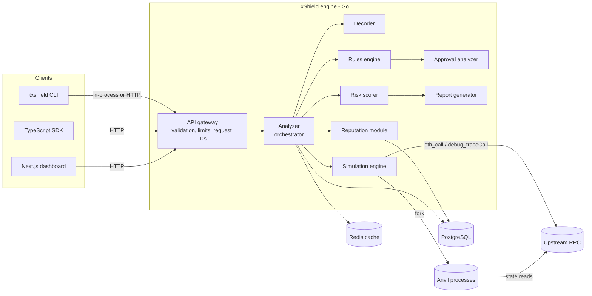

# TxShield Architecture

Status: **Phase 1 design.** Sections marked *(planned)* describe contracts that are
defined in code (`pkg/interfaces`, `pkg/models`) but whose implementations land in
later phases. See [`DEVELOPMENT_STATUS.md`](../DEVELOPMENT_STATUS.md) for what
actually works today.

## 1. Goals and non-goals

TxShield answers, *before* a user signs: what will this transaction do, who does it
touch, which assets move, which permissions does it grant, will it revert, what will
it cost, and how risky does it look to the enabled checks.

Hard non-goals (enforced by design, not configuration):

- TxShield never holds private keys, never signs, never broadcasts.
  There is no code path that calls `eth_sendRawTransaction` / `eth_sendTransaction`
  against an upstream provider.
- TxShield never declares a transaction "safe". The best possible verdict is
  *"No significant risks detected by enabled checks"*, always accompanied by the
  list of checks that ran and the simulation completeness.

## 2. System overview



The **engine** (`internal/analyzer` and everything it depends on) is a Go library
with no HTTP or UI dependencies. The API server, CLI, and tests all drive the
same `Analyzer` value. This is what makes "the core analysis engine works
independently of the frontend" true structurally rather than by convention.

## 3. Analysis pipeline

One request flows through these stages. Every stage receives a `context.Context`
carrying the request deadline and request ID.

1. **Validate** (`pkg/models.TransactionRequest.Validate`). Addresses must be
   20-byte hex, calldata must be valid hex under the configured size limit, fee
   fields must be either legacy (`gasPrice`) or EIP-1559
   (`maxFeePerGas` + `maxPriorityFeePerGas`), never both.
2. **Decode** (`interfaces.Decoder`). Pure, no network. Produces a
   `models.DecodedCall` tree (multicall / router payloads produce children).
   Unknown selectors return `Kind=unknown` with the selector and raw calldata;
   decoding never fails the request.
3. **Gather context** (parallel, bounded):
   - contract facts for every address involved (`eth_getCode`, proxy slots),
   - reputation records (`interfaces.ReputationProvider` chain),
   - token metadata (cached; always marked untrusted).
4. **Simulate** (`interfaces.Simulator`). Optional per request. Produces a
   `models.SimulationResult` with an explicit `completeness`
   (`full` / `partial` / `none`) and a list of reasons when not `full`.
5. **Evaluate rules** (`interfaces.Rule`). Each rule sees an immutable
   `interfaces.AnalysisContext` and returns zero or more `models.Finding`.
   Rules run concurrently with a per-rule timeout; a panicking or erroring rule
   is recorded as an engine warning, not a crash, and lowers report confidence.
6. **Score** (`interfaces.RiskScorer`). Deduplicates findings, combines
   severity x confidence x evidence source, applies simulation adjustments,
   normalizes to 0-100. Fully specified in `docs/risk-scoring.md`.
7. **Report**. Assemble `models.RiskReport`, including the disclaimer,
   enabled checks, and recommended actions.
8. **Persist** (optional). Only when persistence is enabled; subject to retention.

## 4. Module contracts

All cross-module contracts live in `pkg/interfaces` so that new detectors,
simulators, RPC providers, and reputation sources can be added without touching
the orchestrator. Data types live in `pkg/models`. Error kinds live in
`pkg/txerrors`.

| Module | Package | Contract | Notes |
|---|---|---|---|
| API gateway | `internal/api` | `http.Handler` | Middleware: security headers, request ID, recovery, access log, CORS allowlist, optional API keys, per-IP rate limit, timeout, body limit, metrics. OpenAPI generated from handler types. |
| Decoder | `internal/decoder` | `interfaces.Decoder` | Built-in ABIs for ERC-20/721/1155, Permit/Permit2, Uniswap V2/V3 routers, Multicall. |
| Analyzer | `internal/analyzer` | concrete orchestrator | Depends only on interfaces; constructed by DI in `cmd/txshield`. |
| Simulator | `internal/simulator` | `interfaces.Simulator` | `anvil` (fork) backend first; `rpc-trace` (eth_call + debug_traceCall) fallback. |
| Rules engine | `internal/security/rules` | `interfaces.Rule`, `interfaces.RuleEngine` | Registry of rules; each has stable ID, e.g. `TXS-APPROVAL-001`. |
| Approval analyzer | `internal/security/approvals` | `interfaces.Rule` (+ allowance reader) | Decodes approve / increaseAllowance / setApprovalForAll / permit / Permit2. |
| Reputation | `internal/security/reputation` | `interfaces.ReputationProvider` (returns `[]ReputationRecord`) | Postgres records, JSON allow/block lists, external adapters; `Effective()` resolution policy. |
| Risk scoring | `internal/security/scoring` | `interfaces.RiskScorer` | Deterministic; config-driven weights; see `docs/risk-scoring.md`. |
| Shared helpers | `internal/security/core` | functions | Call-tree walk with msg.sender tracking, address collection, finding builder. |
| EVM access | `internal/evm` | `interfaces.ChainReader` | Chain registry, RPC client with retries/backoff/circuit breaker. |
| Persistence | `internal/storage` | `interfaces.AnalysisStore` | PostgreSQL via pgx; optional; privacy options applied before storing; retention purge worker. |
| SSRF guard | `internal/netguard` | functions | Public-IP checks at resolution and dial time for user-supplied URLs. |
| Cache | `internal/cache` | `interfaces.Cache` | Redis optional; in-memory LRU fallback. |
| Config | `internal/config` | `config.Config` | Env-based (12-factor), validated at startup. |

### 4.1 Rule contract

Approval grants are extracted once per analysis (`approvals.Extract`) with
`msg.sender` tracking through nested calls, so a grant made by an intermediary
(e.g. Multicall3) is not confused with the user's own approval.

```go
type Rule interface {
    Metadata() models.RuleMetadata // ID, name, description, default severity,
                                   // category, false-positive notes, mitigation
    Evaluate(ctx context.Context, ac *AnalysisContext) ([]models.Finding, error)
}
```

Every `Finding` carries `source` — one of `fact` (directly observed from calldata,
chain state, or simulation), `heuristic` (inferred pattern), or `external`
(third-party reputation) — so reports always distinguish facts from opinions.

### 4.2 Simulator contract

```go
type Simulator interface {
    Name() string
    Capabilities() models.SimulatorCapabilities
    Simulate(ctx context.Context, req SimulationRequest) (*models.SimulationResult, error)
}
```

Error semantics are deliberately split:

- **Transaction reverted** → `err == nil`, `result.Status == "reverted"`,
  revert reason decoded when possible. This is a *finding about the tx*.
- **Infrastructure failure** (RPC down, Anvil failed to start, timeout) →
  `err` is a `txerrors.Error` of kind `Unavailable` / `Timeout`. The analyzer
  then produces a report with `completeness: none` and lowered confidence; it
  does **not** treat infrastructure failure as "the tx would fail".

### 4.3 Simulation design

Implemented in Phase 4; full details in [`docs/simulation.md`](simulation.md).

**Primary backend: Anvil worker pool.** A fixed pool of workers, each owning
one private Anvil process on `127.0.0.1`. Each job re-forks its worker at the
pinned block (`anvil_reset`), impersonates the sender (no keys), executes with
fees zeroed, then collects the receipt, `callTracer` trace, parsed events, and
the sender's balance diffs. Workers in an unknown state after an error are
killed and restarted.

The original design started one process per simulation. Measurement changed
that: re-forking a warm process costs ~26 ms versus 50-100 ms for a cold
start. Isolation is preserved because each worker runs one job at a time and
every job starts from a fresh fork.

**Fallback backend: `rpc-trace`.** Upstream `debug_traceCall` (callTracer +
logs), falling back to `eth_call` when debug methods are unavailable. Always
`partial`: without post-state there are no balance diffs.

Block-dependent execution: the analyzer resolves the transaction's block
reference **once** (`ChainReader.ResolveBlock`), and contract inspection,
simulation, and balance reads all use that block. The report states it.

## 5. Configuration and trust of RPC endpoints

- Operators configure RPC endpoints per chain (`TXSHIELD_RPC_URLS`, http/https
  only). These are trusted, but each endpoint's `eth_chainId` is verified on
  first use, and upstream clients may only call read methods.
- The HTTP API selects a chain by ID; it does **not** accept arbitrary RPC URLs
  by default (`TXSHIELD_ALLOW_USER_RPC=false`). When enabled, user-supplied URLs
  pass through an SSRF guard (https only, every resolved IP must be public, IP re-checked at
  connect time, redirects refused). User URLs only get the `rpc-trace`
  simulator, because Anvil would make its own unguarded connections.
- The CLI accepts `--rpc` freely, because the CLI user is the operator.

## 6. Persistence

PostgreSQL is optional. Without `TXSHIELD_DATABASE_URL` the engine runs stateless
(CLI, CI usage) and dashboard history endpoints return `503 persistence_disabled`.

Schema (see `migrations/000001_init.up.sql`):

| Table | Purpose |
|---|---|
| `analyzed_transactions` | One row per stored analysis; full report as JSONB plus indexed summary columns. Sender address stored only if `TXSHIELD_STORE_SENDER=true`. |
| `simulation_results` | Simulation outcome per analysis (backend, block, gas, status, completeness). |
| `security_findings` | Normalized findings for querying by rule/severity. |
| `contract_metadata` | Observed on-chain facts (code hash, size, proxy implementation). |
| `contract_reputation` | Reputation records with explicit `source_kind` (local / list / external). |
| `token_metadata` | Cached token info. `symbol`/`name` are **untrusted display strings**. |
| `analysis_history` | Address → analysis ledger (role: sender / target / spender / recipient / interacted) powering the Address Inspector. |

Every analysis row carries `expires_at`; a retention worker deletes expired rows
(hourly). Raw calldata is stored only when `TXSHIELD_STORE_CALLDATA=true`;
otherwise only its keccak256 and selector.

## 7. Reliability

- Context propagation end-to-end; per-request deadline (`TXSHIELD_REQUEST_TIMEOUT`).
- Bounded concurrency: global semaphore for simulations, per-request errgroup
  limit for context gathering.
- RPC client: retries with exponential backoff + full jitter for idempotent reads
  only; circuit breaker per endpoint; connection pooling via shared `http.Transport`.
- Graceful shutdown: stop accepting, drain in-flight requests up to
  `TXSHIELD_SHUTDOWN_TIMEOUT`, kill Anvil workers, close pools.
- Observability: `log/slog` JSON logs with request IDs and sanitized
  user-controlled values; Prometheus metrics on `/metrics`.

## 8. Technical risks

| Risk | Impact | Mitigation |
|---|---|---|
| Fork simulation diverges from real execution (block.timestamp, basefee, MEV, state changes between sim and inclusion) | False confidence | Report the exact block simulated; flag time-sensitive patterns; never call results proof of safety. |
| Malicious contracts detect simulation (e.g. check `block.coinbase`, gas left, impersonation artifacts) | Benign-looking sim of a malicious tx | Document limitation; heuristic rule for env-dependent branching (Phase 3+); combine sim with static/approval checks. |
| Upstream providers lack `debug_*` APIs | Missing traces | Anvil fork produces traces locally regardless of provider support; completeness flag. |
| Anvil startup latency and memory under load | Throughput | Bounded pool, timeouts, benchmarks in Phase 8 before optimizing. |
| Selector collisions (4-byte) | Wrong decode | Prefer verified ABI when provided; mark selector-only decodes with lower confidence; show all candidates. |
| Untrusted token metadata (fake "USDC" symbols) | Social-engineering via report | Display metadata as untrusted; identify tokens by address; known-token list keyed by `(chainId, address)` only. |
| RPC endpoint abuse / SSRF | Infra compromise, cost | No user RPC by default; SSRF guard; rate limits; request size limits. |
| Proxy contracts hide real logic | Missed detections | Resolve EIP-1967 / EIP-1822 / beacon implementation slots; report implementation address. |

## 9. Ambiguities and decisions taken

1. **`pkg/errors` naming.** A package named `errors` shadows the standard library
   everywhere it is imported. Implemented as `pkg/txerrors`.
2. **`analysis_history` vs `analyzed_transactions`.** The spec lists both without
   distinguishing them. Decision: `analyzed_transactions` holds the analysis;
   `analysis_history` is the per-address interaction ledger the Address Inspector
   needs.
3. **Storing addresses.** The spec asks to avoid sensitive user info but also
   wants interaction history. Decision: contract/target addresses are stored
   (public on-chain data); the sender address is stored only when explicitly
   enabled.
4. **"Transaction hash" input in the scanner.** Analyzing an already-mined tx is
   re-simulation of a historical transaction at its parent block. Supported in
   Phase 4 via `eth_getTransactionByHash`; clearly labeled as historical replay.
5. **Slither.** Optional: it needs verified Solidity source, which TxShield does
   not fetch from paid services. Integrated as an optional adapter that runs only
   on user-supplied or locally available sources, in a sandboxed subprocess with
   timeouts. Never runs on arbitrary bytecode.
6. **Config format.** Environment variables only for now (Docker-friendly, no
   YAML dependency). A config file can be added if per-chain options grow.
7. **CLI framework.** Standard library `flag` with a small subcommand dispatcher;
   avoids a framework dependency for ~6 commands.
8. **License.** Apache-2.0 (explicit patent grant, common for security infra).

## 10. Implementation plan

| Phase | Deliverable | Exit criteria |
|---|---|---|
| 1 Foundation | Repo layout, models, interfaces, errors, config, HTTP server with `/health`, `/livez`, `/metrics`, graceful shutdown, migrations, Docker Compose, CI | `go build`, `go vet`, `go test -race` pass; migrations apply in CI |
| 2 Decoder | ABI registry, ERC-20/721/1155, Permit/Permit2, Uniswap V2/V3, Universal Router, Multicall, contract creation, unknown fallback; `txshield decode` | Table tests per standard incl. malformed calldata; benchmarks |
| 3 Security engine | Rule registry, approval analyzer, interaction/value/dangerous-pattern rules, reputation providers, scorer with dedup, `docs/risk-scoring.md` | Unit tests incl. false-positive cases; Solidity fixtures compiled with Foundry |
| 4 Simulation | Anvil fork backend, rpc-trace backend, balance diffs, event parsing, traces | Integration tests against local Anvil (no mainnet in CI) |
| 5 API & CLI | `/api/v1/analyze`, `/simulate`, `/approvals/analyze`, `/address/{a}`, OpenAPI, rate limiting, SSRF guard, CLI commands, exit codes | httptest + integration tests; OpenAPI validated |
| 6 TS SDK | Typed client, validation, timeouts, errors, examples | Unit tests + integration against a running server |
| 7 Dashboard | Next.js scanner, report, address inspector, stats | Builds; e2e smoke against real API; demo fixtures labeled |
| 8 Hardening | Security review, benchmarks with methodology, docs, release workflow | Reproducible benchmarks published; release artifacts |
